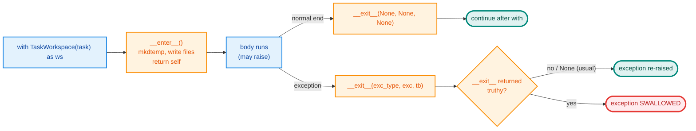

# Python refresher: concepts used in the Ch 1 code

A quick revision sheet for the Python features used in `src/les/scratch/ch01/` and `src/les/contracts/`.
Every "gotcha" below was **checked by running it** (Python 3.14; the project supports 3.10+).

| # | Concept | One-line reminder |
|---|---|---|
| 1 | `@dataclass` | Generates `__init__`, `__repr__` and `__eq__` from annotated fields |
| 2 | `field(default_factory=...)` | The only safe way to default a field to a list or dict |
| 3 | `frozen=True` | Immutable *fields*, hashable instances, but only **shallow** |
| 4 | `Protocol` | Interface by *shape* (duck typing) with no inheritance needed |
| 5 | `@runtime_checkable` | Lets `isinstance()` check a Protocol, but only that **names exist** |
| 6 | `__enter__` / `__exit__` | Setup and guaranteed cleanup for `with` blocks |
| 7 | Small extras | `@property`, `str` Enum, `__test__ = False`, `x or default`, `from __future__ import annotations` |

---

## 1. `@dataclass`

**What:** a decorator that writes the boring methods for you, based on the class's **type-annotated** attributes.

```python
from dataclasses import dataclass

@dataclass
class TestRun:
    passed: bool
    output: str

r = TestRun(passed=False, output="FAILED 1")   # __init__ generated
print(r)                                        # TestRun(passed=False, output='FAILED 1')
r == TestRun(False, "FAILED 1")                 # True: __eq__ compares fields
```

**Where we used it:** `TestRun` (`workspace.py`), `RunnerScore` (`compare.py`), and `LoopResult`, `ToolInput`, `ToolOutput` and `VerifyResult` (`contracts/protocols.py`).

**Useful extras**

```python
from dataclasses import field, fields, replace

field(default_factory=list)        # fresh default per instance
field(init=False)                  # not an __init__ argument; set in __post_init__
replace(obj, x=5)                  # copy with one field changed (works on frozen too)
[f.name for f in fields(obj)]      # introspect fields

def __post_init__(self): ...       # runs right after the generated __init__ (validation, derived fields)
```

### ⚠️ Gotchas

**a) Mutable defaults are rejected.**
```python
@dataclass
class Bad:
    xs: list = []
# ValueError: mutable default <class 'list'> for field xs is not allowed: use default_factory
```
Use `xs: list = field(default_factory=list)`. This is how `LoopResult.metadata` and `RunnerScore.results` are defined. (A plain class has the classic shared-mutable-default bug; dataclasses refuse it outright.)

**b) Fields with defaults must come after fields without defaults.**
```python
@dataclass
class Bad2:
    a: int = 0
    b: int          # TypeError: non-default argument 'b' follows default argument 'a'
```
That's why `FixTask.wrong_fix: str = ""` is the **last** field.

**c) Only annotated attributes become fields.**
```python
@dataclass
class TestRun:
    __test__ = False   # no annotation → plain class attribute, NOT a field
    passed: bool
# fields: ['passed']
```

**d) A regular (non-frozen) dataclass is *unhashable*.** `@dataclass` adds `__eq__`, which sets `__hash__ = None`, so `{TestRun(...)}` raises `TypeError: unhashable type`. Use `frozen=True` (next section) if you need instances in sets or as dict keys.

---

## 2. `frozen=True`

**What:** `@dataclass(frozen=True)` blocks assignment to fields after construction, and as a bonus generates `__hash__`.

```python
@dataclass(frozen=True)
class FixTask:
    task_id: str
    function: str
    ...

t = FIX_TASKS[0]
t.task_id = "x"       # dataclasses.FrozenInstanceError: cannot assign to field 'task_id'
{t, t}                # works: frozen dataclasses are hashable
```

**Where we used it:** `FixTask` (`tasks.py`). Tasks are constants shared by every run, so nothing should be able to mutate them mid-experiment. `ModelSpec` (`models/spec.py`) is frozen for the same reason.

**Why it matters for loops:** immutable inputs mean one runner can't silently corrupt the task another runner gets. That is the same reasoning as "fresh runner per task" in `compare.py`.

### ⚠️ Gotchas

**a) Frozen is *shallow*.** The field can't be reassigned, but a mutable object *inside* it can still change:
```python
@dataclass(frozen=True)
class P:
    x: int
    tags: list = field(default_factory=list)

p = P(1)
p.tags.append("a")     # allowed! p.tags is now ['a']
hash(p)                # TypeError: unhashable type: 'list'
```
For truly immutable data, use immutable field types: `str`, `int`, `tuple`, `frozenset`. (`FixTask` only has `str` fields, so it's fully immutable.)

**b) Setting a derived field in `__post_init__` needs a workaround,** because `self.x = ...` is blocked there too:
```python
@dataclass(frozen=True)
class R:
    a: int
    double: int = field(init=False)
    def __post_init__(self):
        object.__setattr__(self, "double", self.a * 2)   # bypasses the freeze
# R(a=3, double=6)
```
In `FixTask` we avoided this by using `@property` for derived values (`goal`, `first_attempt`), which is simpler.

**c) "Changing" a frozen object means making a new one:** `replace(t, wrong_fix="")`.

---

## 3. `Protocol`: structural typing

**What:** a `typing.Protocol` describes an interface by **shape**: "anything with a `run(goal)` method and a `get_state()` method is a `LoopRunner`". Classes do **not** inherit from it. This is duck typing that a type checker (mypy) can verify.

```python
from typing import Any, Protocol

class LoopRunner(Protocol):
    def run(self, goal: str, **kwargs: Any) -> LoopResult: ...
    def get_state(self) -> dict[str, Any]: ...

class AnatomyLoop:                 # no base class!
    def run(self, goal: str, **kwargs: Any) -> LoopResult: ...
    def get_state(self) -> dict[str, Any]: ...

def score(r: LoopRunner) -> None: ...
score(AnatomyLoop())               # mypy: OK, the shapes match
```

**Where we used it:** `LoopRunner`, `Verifier` and `ToolSpec` (`contracts/protocols.py`), plus the lab's `LLMClient`. Implementations: `SingleShotChain` and `AnatomyLoop` → `LoopRunner`; the three tools → `ToolSpec`; `TestsPassVerifier` → `Verifier`.

**Protocol vs ABC (abstract base class)**

| | `Protocol` | `ABC` + `@abstractmethod` |
|---|---|---|
| Implementer must inherit? | **No** | Yes |
| Works with third-party classes you can't edit? | **Yes** | No |
| Missing method detected | by mypy (static) | at instantiation (`TypeError`) |
| Fits | "plug-in" contracts across builds (scratch vs LangGraph vs SDK) | a family of classes you own |

We chose Protocols because the LangGraph build (Task 5) and the SDK comparison spikes shouldn't have to inherit from our classes. They only need the right shape.

**Property in a protocol, plain attribute in the implementation.** `ToolSpec` declares `name` as a `@property`, but `ReadFileTool` just has `name = "read_file"`. That still matches, because a property only says "there is a readable attribute called `name`".

---

## 4. `@runtime_checkable`

**What:** a plain Protocol only exists for the type checker. Add `@runtime_checkable` and `isinstance(obj, LoopRunner)` works at runtime, which our contract tests rely on:

```python
from typing import Protocol, runtime_checkable

@runtime_checkable
class LoopRunner(Protocol): ...

assert isinstance(AnatomyLoop(), LoopRunner)    # tests/contract/test_ch01_contract.py
```

### ⚠️ Gotchas (all checked)

**a) It only checks that the *names exist*: not signatures, not types, not even that it's callable.**
```python
@runtime_checkable
class Runner(Protocol):
    def run(self, goal: str) -> int: ...

class Wrong:
    def run(self): return "nope"     # wrong args, wrong return type
class NotEvenAMethod:
    run = 5                          # not callable at all

isinstance(Wrong(), Runner)          # True  (!)
isinstance(NotEvenAMethod(), Runner) # True  (!)
```
So `isinstance` is a cheap *smoke test*. Real correctness comes from **mypy** (signatures) and **contract tests** (behaviour). That's why `test_ch01_contract.py` actually *calls* `run()` and checks the returned `LoopResult`.

**b) Without the decorator, `isinstance` raises:**
```
TypeError: Instance and class checks can only be used with @runtime_checkable protocols
```

**c) Protocols with data members (`name: str`) work with `isinstance` but not `issubclass`:**
```
TypeError: Protocols with non-method members don't support issubclass(). Non-method members: 'name'.
```

**d) It's slow-ish** (it inspects attributes on each call). That's fine in tests, but avoid it in hot loops.

---

## 5. Context managers: `__enter__` / `__exit__`

**What:** an object usable in a `with` block. `__enter__` runs at the start, and `__exit__` runs at the end, **always**, even if the block raises. This is the right tool for anything that must be cleaned up: temp dirs, files, locks, connections.

```python
with TaskWorkspace(task) as ws:     # 1. __enter__ runs; its RETURN VALUE is bound to ws
    ws.write("solution.py", code)   # 2. body runs
    ws.run_tests()
# 3. __exit__ runs here, even on exception → temp dir deleted
```



**Our implementation (`workspace.py`):**
```python
class TaskWorkspace:
    def __enter__(self) -> TaskWorkspace:
        self._tmp = tempfile.TemporaryDirectory(prefix=...)
        self.root = Path(self._tmp.name)
        ...write solution.py and test_solution.py...
        return self                       # ← what `as ws` receives

    def __exit__(self, exc_type, exc, tb) -> None:
        if self._tmp is not None:
            self._tmp.cleanup()
            self._tmp = None
        # returns None → exceptions propagate (what we want)
```

**The three `__exit__` arguments** are `(exc_type, exc_value, traceback)`. All three are `None` when the block finished normally.

### ⚠️ Gotchas (all checked)

**a) Forgetting `return self` in `__enter__`:** then `ws` is `None` and you get `AttributeError: 'NoneType' object has no attribute ...` on the next line.

**b) Returning `True` from `__exit__` silently swallows the exception.**
```python
class CM:
    def __enter__(self): return "value"
    def __exit__(self, et, ev, tb): return True    # ⚠️

with CM():
    raise ValueError("boom")
print("still running")        # runs; the ValueError vanished
```
Only do this deliberately (like `contextlib.suppress`). Ours returns `None`, so errors propagate.

**c) Make `__exit__` safe to call twice.** That's why we set `self._tmp = None` after cleanup.

**d) Values computed inside the block survive it, but resources don't.** In `AnatomyLoop.run()` we read the final code *inside* the `with` (`final_code = ws.read(...)`), because after `__exit__` the directory is gone.

**The shortcut: `@contextmanager`**, for when you don't need a class:
```python
from contextlib import contextmanager

@contextmanager
def workspace(task):
    tmp = tempfile.TemporaryDirectory()
    try:
        yield Path(tmp.name)        # ← value for `as`
    finally:
        tmp.cleanup()               # ← always runs, like __exit__
```

---

## 6. Small extras worth remembering

**`@property`** is a method read like an attribute, with no parentheses:
```python
@property
def first_attempt(self) -> str:
    return self.wrong_fix or self.correct_fix

task.first_attempt     # not task.first_attempt()
```
Used for derived values (`FixTask.goal`, `RunnerScore.solved`, `LLMResponse.wants_tool`).

**`class StopReason(str, Enum)`** makes members real strings, so they compare equal to plain strings and serialise to JSON nicely:
```python
StopReason.SUCCESS == "success"     # True
StopReason.SUCCESS.value            # 'success'
f"{StopReason.SUCCESS}"             # 'StopReason.SUCCESS'  ⚠️ (Python 3.11+; was 'success' before)
```
⚠️ Use `.value` when you need the string in f-strings or logs. On 3.11+ you can also use `enum.StrEnum`, whose `str()` *is* the value.

**`__test__ = False`:** pytest collects any class whose name starts with `Test`. `TestRun` and `TestsPassVerifier` aren't tests, so this flag tells pytest to skip them. Without it pytest warns "cannot collect test class because it has a `__init__` constructor".

**`x or default` treats every *falsy* value as missing:**
```python
task = kwargs.get("task") or self.task   # loop.py: fine, a FixTask object is always truthy
d = {"n": 0}
d.get("n") or 10                         # 10  ⚠️ (0 is falsy!)
```
For numbers, strings or lists where `0`, `""` or `[]` are valid values, write `x if x is not None else default`.

**`from __future__ import annotations`:** annotations are stored as strings and not evaluated at import time. That lets you write `def __enter__(self) -> TaskWorkspace` inside the class itself (a forward reference) and use `list[str]` or `X | None` syntax on Python 3.10.

**`**kwargs` in a Protocol method:** `run(self, goal, **kwargs)` lets each runner accept extra options (`task=...`) while still matching the shared `LoopRunner` contract.

---

## 7. Quick self-check

1. Why does `FixTask` use `frozen=True` but `RunnerScore` doesn't?
2. `isinstance(x, LoopRunner)` is `True`. Is `x.run("goal")` guaranteed to work? Why not?
3. What does `with TaskWorkspace(t) as ws:` bind to `ws` if `__enter__` has no `return`?
4. What happens to an exception raised inside a `with` block when `__exit__` returns `True`?
5. Why must `wrong_fix: str = ""` be the last field in `FixTask`?
6. `@dataclass class A: items: list = []`: what happens, and what's the fix?

<details>
<summary>Answers</summary>

1. Tasks are shared constants that must never change during an experiment. `RunnerScore` is a private accumulator owned by one `compare()` call, so nothing else shares it and freezing buys nothing. (Freezing wouldn't even stop `score.results[id] = ...`, since frozen is shallow: it blocks reassigning `results`, not mutating the dict.)
2. No. `runtime_checkable` only checks that a `run` attribute exists, not its signature or that it's callable. Contract tests and mypy cover the rest.
3. `None`.
4. It is swallowed, and execution continues after the `with`.
5. Fields with defaults can't come before fields without defaults (`TypeError`).
6. `ValueError` at class definition. Use `items: list = field(default_factory=list)`.

</details>
