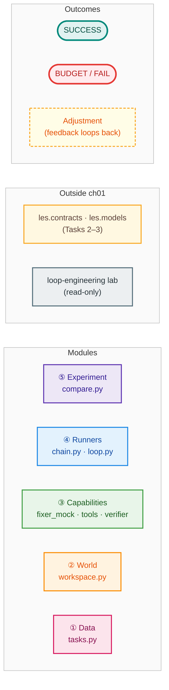
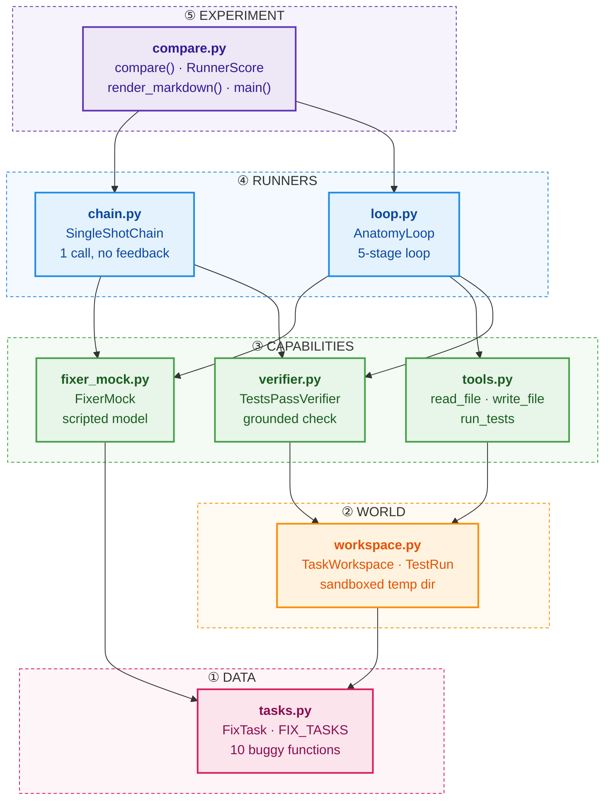
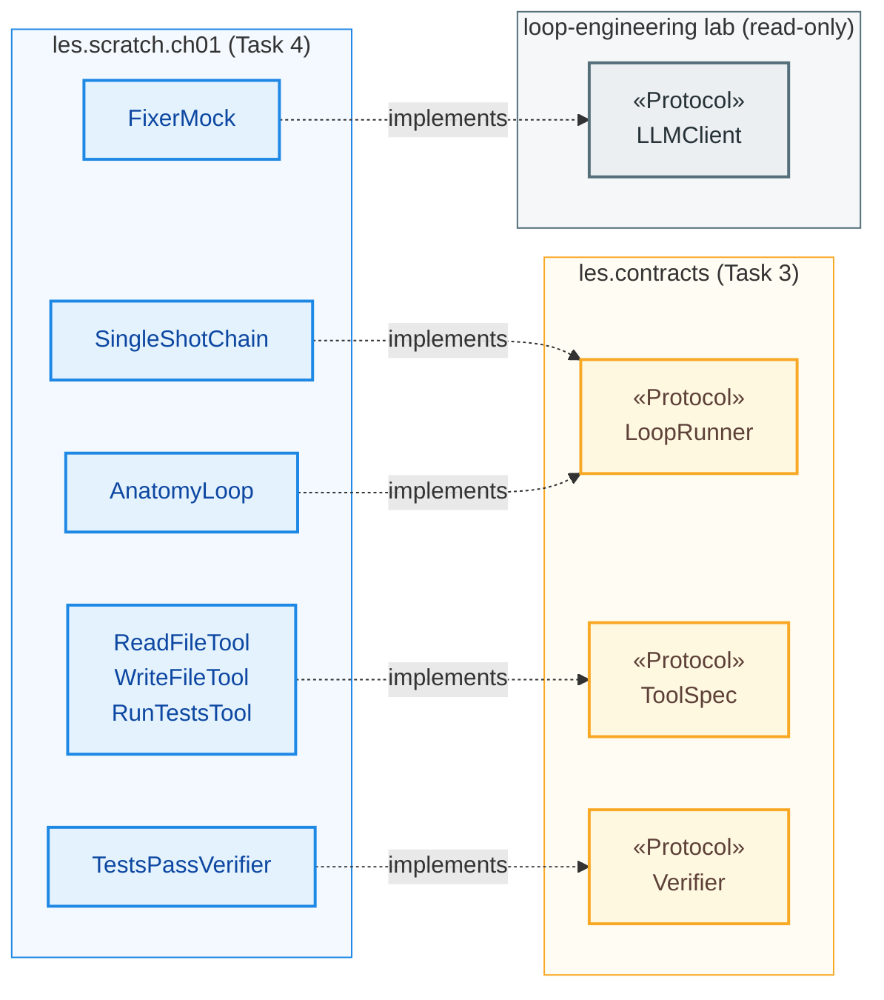
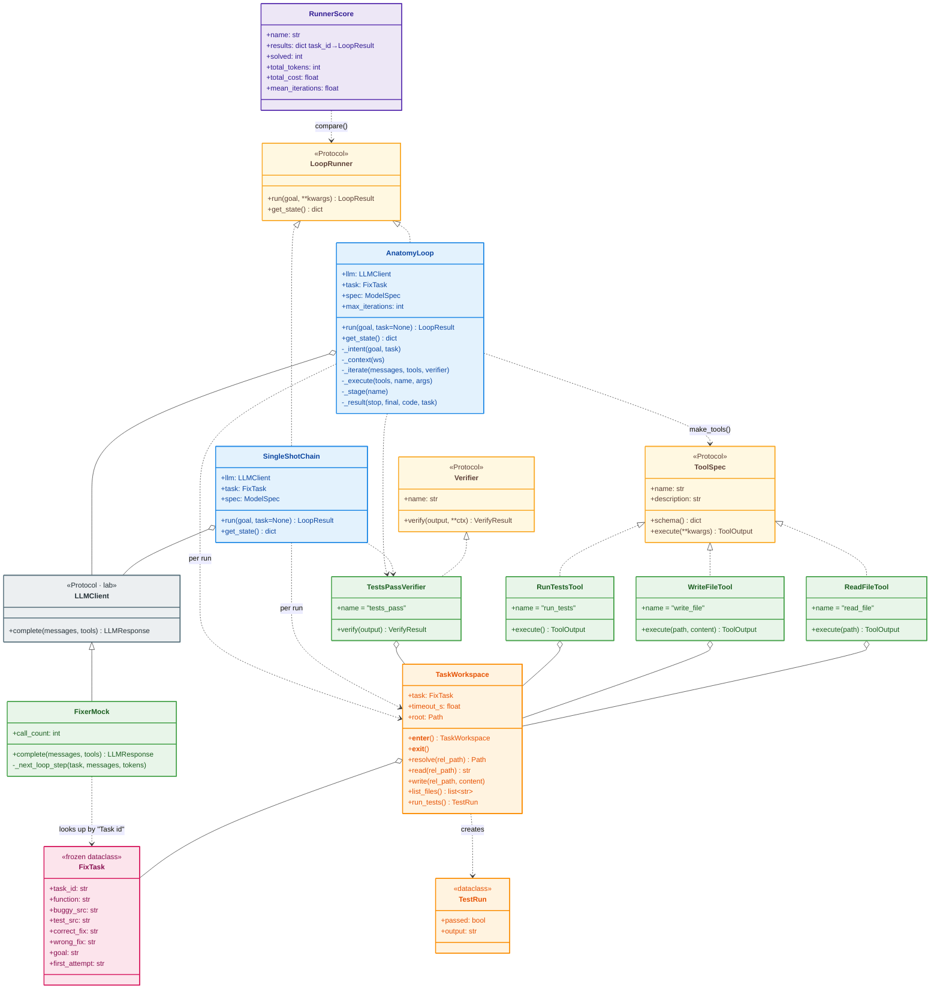
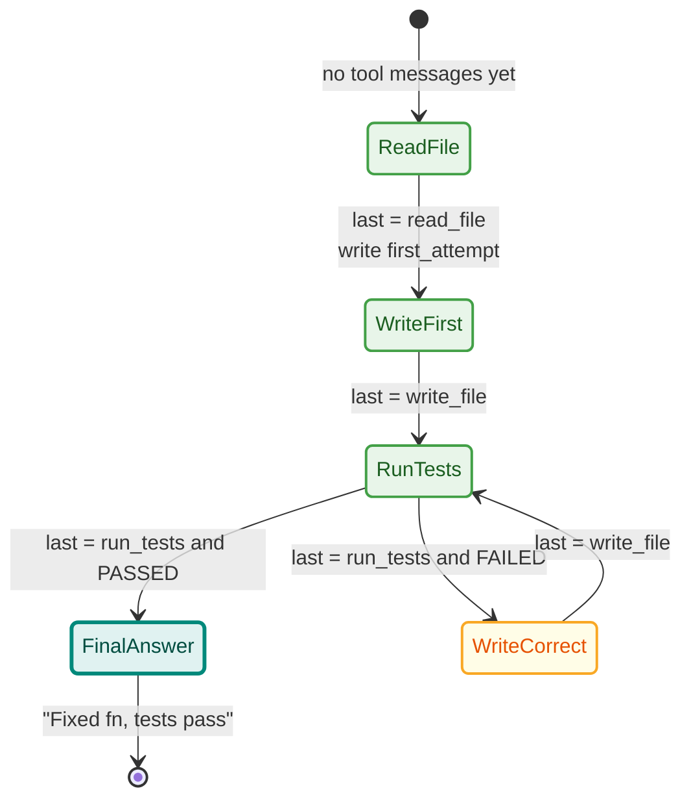
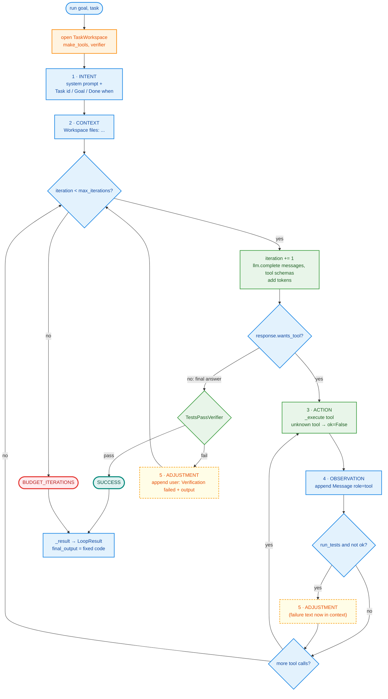
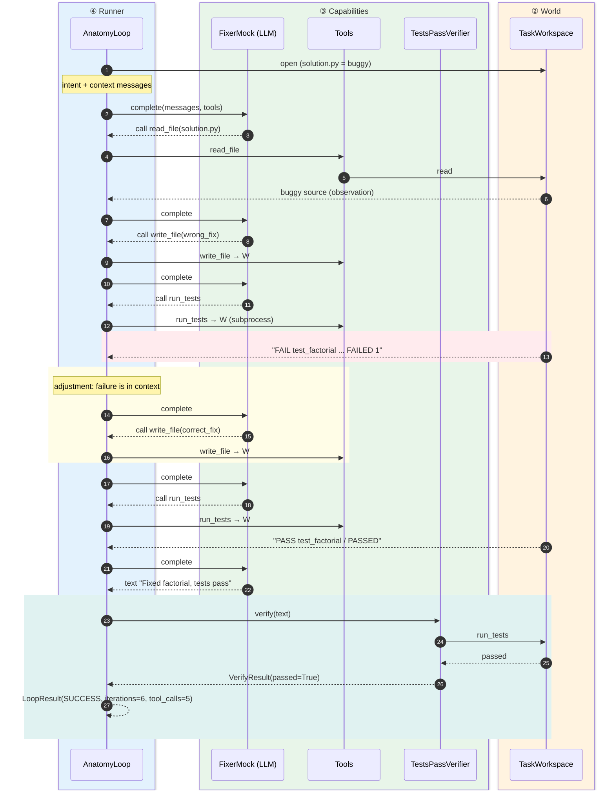
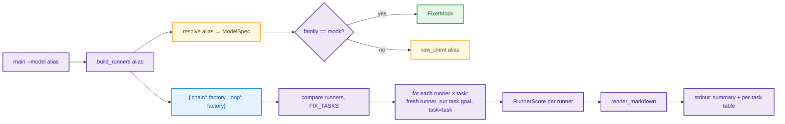

# Task 4: Ch 1 scratch build, single-shot chain vs loop

> Module: `src/les/scratch/ch01/` · Tests: `tests/scratch/test_ch01_*.py`, `tests/contract/test_ch01_contract.py`
> Run: `uv run python -m les.scratch.ch01.compare` (add `--model <alias>` for a real model)

This document walks through every piece of code written for Task 4: what each part does, why it is shaped that way, and how the parts fit together.

---

## 1. What Task 4 demonstrates

Chapter 1's central claim is that **a loop beats a chain because a loop can observe the consequences of its actions and adjust**.

- A **chain** sends a prompt, gets an answer and stops. If the answer is wrong, nothing notices.
- A **loop** acts, observes the result, adjusts and repeats until a *grounded* check passes or a budget runs out.

To make this measurable we built the **"Fix the function" mini-lab**: 10 small Python functions, each with a bug and a failing test. Both approaches get the same tasks, and the same verifier judges both: *do the tests pass?*

| Runner | Solved | Mean iterations | Tokens |
|---|---|---|---|
| `SingleShotChain` | 5/10 | 1.0 | 1,449 |
| `AnatomyLoop` | 10/10 | 5.0 | 7,797 |

*(Scripted mock model. Five tasks have a "plausible but wrong" first fix, and the chain fails exactly those five.)*

The trade-off is also visible: the loop spends about **5× the tokens**. Reliability costs compute, and that cost is something we will manage later with budgets (Ch 3) and cost routing (Ch 15).

### The five-stage anatomy

| Stage | Meaning | Where in code |
|---|---|---|
| 1. **Intent** | State the goal and what "done" means | `AnatomyLoop._intent()` |
| 2. **Context** | Ground the model in the real world (here: the workspace file list) | `AnatomyLoop._context()` |
| 3. **Action** | The model chooses a tool call, which we execute | `_iterate()` → `_execute()` |
| 4. **Observation** | The tool result is appended to the conversation | `_iterate()`: `messages.append(Message("tool", ...))` |
| 5. **Adjustment** | Failures (red tests, a rejected answer) shape the next turn | `_iterate()`: failing `run_tests`, or a `"Verification failed"` message |

---

## Colour key (used in every diagram)

Each box is coloured by the **module that owns it**. Outcomes get their own colours.



## 2. Package map

The package is easiest to read as **two views**: the layers *inside* `ch01`, and the *contracts* each module fulfils from outside it.

### 2a. Layers inside `les.scratch.ch01`

Each arrow means **"uses / imports"** and always points **downward**. A layer only depends on layers below it, never on layers above.



| Layer | Role | Question it answers |
|---|---|---|
| ① Data | The task definitions | *What* is broken? |
| ② World | A real directory plus a test runner | *Where* does the agent act, and what is true? |
| ③ Capabilities | Model, tools, verifier | *How* can the agent think, act and be judged? |
| ④ Runners | Chain vs loop | *In what pattern* are the capabilities combined? |
| ⑤ Experiment | Run both, score both | *Which pattern* works better, at what cost? |

### 2b. Contracts each module implements

The left side is **our code (Task 4)**. The right side is the **interfaces it plugs into**, defined earlier (Task 3) or in the lab. Because of these contracts, the LangGraph build in Task 5 can be swapped in and tested with the same contract tests.



### 2c. Other things `ch01` uses from outside

These are plain uses (data types and helpers), not contracts, so they are kept out of the diagrams:

| Used by | From | What |
|---|---|---|
| `chain.py`, `loop.py` | `les.contracts` | `LoopResult`, `StopReason`, `ToolOutput`, `VerifyResult` (return types) |
| `chain.py`, `loop.py` | `les.models` | `ModelSpec` (token prices, used for `cost_usd`) |
| `compare.py` | `les.models` | `resolve()`, `raw_client()` (turn `--model alias` into a client) |
| `chain.py`, `loop.py`, `fixer_mock.py` | lab `llm.base` | `Message`, `LLMResponse`, `ToolCall` |

---

## 3. Class diagram



**Reading the diagram**
- Dotted arrows with a hollow triangle (`<|..`) mean *structurally satisfies a Protocol*. There is no inheritance. Python's `runtime_checkable` Protocols let `isinstance(x, LoopRunner)` check that the methods exist, and the tests rely on this.
- `FixerMock` *does* subclass the lab's `LLMClient`, following the lab's own `MockLLM` convention.
- Each `run()` creates a **fresh `TaskWorkspace`**, so runs never share state.

---

## 4. File-by-file walkthrough

### 4.1 `tasks.py`: the task set

```python
@dataclass(frozen=True)
class FixTask:
    task_id: str
    function: str
    buggy_src: str
    test_src: str
    correct_fix: str
    wrong_fix: str = ""   # optional plausible-but-wrong first attempt

    @property
    def first_attempt(self) -> str:
        return self.wrong_fix or self.correct_fix
```

- **10 tasks:** `add`, `is_even`, `factorial`, `reverse`, `max_of`, `fizzbuzz`, `count_vowels`, `mean`, `palindrome`, `clamp`.
- **5 carry a `wrong_fix`:** a fix that *looks* right but still fails a test. Examples:
  - `factorial`: changes `range(1, n)` to `range(n)`, so it multiplies by 0.
  - `max_of`: changes `>` to `>=` but still starts at `best = 0`, so all-negative lists fail.
  - `palindrome`: adds `.lower()` but doesn't strip punctuation.
- `frozen=True`: tasks are constants and nothing may mutate them.
- `TASKS_BY_ID` gives the mock O(1) lookup.

**Why have wrong fixes at all?** They model the realistic failure the chapter is about: a model that pattern-matches the bug and stops without checking. Every task's semantics is tested (see §6), so a buggy source must fail, a correct fix must pass, and a wrong fix must fail.

### 4.2 `workspace.py`: the sandboxed world

`TaskWorkspace` is a context manager that:

1. **`__enter__`** creates a temp dir (`les-ch01-<task>-xxxx`) and writes `solution.py` (buggy) and `test_solution.py` (the tests plus a small harness).
2. **`resolve()`** turns relative paths into absolute ones and **rejects anything that escapes the dir** (`../../etc/passwd` → `ValueError`).
3. **`write()`** refuses to touch `test_solution.py`, so the agent cannot "fix" the tests instead of the code. This is a reward-hacking guard (it previews Ch 8 and Ch 14).
4. **`run_tests()`** runs `python -B -E -s test_solution.py` in a **subprocess with a timeout** and never raises. A syntax error, an infinite loop or a crash all come back as `TestRun(passed=False, output=...)`.
5. **`__exit__`** deletes the dir, even if the run raised.

**The test harness.** Instead of invoking pytest (about 300 ms per call), each test file gets a short `__main__` block. It runs every `test_*` function, prints `PASS`/`FAIL` with tracebacks, prints `PASSED` or `FAILED n`, and exits 0 or 1. That keeps each test run around 30 ms, so the full comparison finishes in about a second.

```mermaid
flowchart LR
    A[with TaskWorkspace task] --> B[mkdtemp]
    B --> C[write solution.py = buggy_src]
    C --> D[write test_solution.py = test_src + harness]
    D --> E[tools / verifier use ws]
    E --> F[__exit__: rmtree]
    E -. run_tests .-> G[subprocess python test_solution.py<br/>cwd=root, timeout]
    G --> H{exit code}
    H -- 0 --> I[TestRun passed=True]
    H -- 1 / crash --> J[TestRun passed=False, output]
    G -- timeout --> K[TestRun passed=False, TIMEOUT]

    classDef exp    fill:#ede7f6,stroke:#5e35b1,stroke-width:2px,color:#311b92
    classDef run    fill:#e3f2fd,stroke:#1e88e5,stroke-width:2px,color:#0d47a1
    classDef cap    fill:#e8f5e9,stroke:#43a047,stroke-width:2px,color:#1b5e20
    classDef world  fill:#fff3e0,stroke:#fb8c00,stroke-width:2px,color:#e65100
    classDef data   fill:#fce4ec,stroke:#d81b60,stroke-width:2px,color:#880e4f
    classDef shared fill:#fff8e1,stroke:#f9a825,stroke-width:2px,color:#5d4037
    classDef lab    fill:#eceff1,stroke:#546e7a,stroke-width:2px,color:#263238
    classDef ok     fill:#e0f2f1,stroke:#00897b,stroke-width:3px,color:#004d40
    classDef fail   fill:#ffebee,stroke:#e53935,stroke-width:3px,color:#b71c1c
    classDef adjust fill:#fffde7,stroke:#f9a825,stroke-width:2px,color:#e65100,stroke-dasharray:5 3

    class A,B,C,D,F,G,H world
    class E cap
    class I ok
    class J,K fail
```



**Flags:** `-B` writes no `.pyc` files. `-E` ignores `PYTHON*` env vars. `-s` skips user site-packages. We deliberately do **not** use `-I`, because isolated mode drops the script's directory from `sys.path` and then `from solution import ...` would fail.

### 4.3 `tools.py`: the agent's capabilities

Three classes satisfy the `ToolSpec` protocol:

| Tool | Args | Returns |
|---|---|---|
| `ReadFileTool` | `path` | file content, or `ok=False` with an error |
| `WriteFileTool` | `path`, `content` | `"wrote N chars"`, or `ok=False` (path escape, test file) |
| `RunTestsTool` | none | test output, `ok = passed`, `data={"passed": bool}` |

The key rule is that **tools never raise**. Every failure becomes `ToolOutput(ok=False, content="...error...")`. That matters for the loop: an exception would crash it, while an error *message* is an observation the model can read and react to. That is stage 5, adjustment.

Helpers:
- `make_tools(ws)` returns `{"read_file": ..., "write_file": ..., "run_tests": ...}`, all bound to one workspace.
- `function_schemas(tools)` wraps each `ToolSpec.schema()` (bare JSON Schema) in the OpenAI `{"type": "function", "function": {...}}` envelope that `LLMClient.complete(tools=...)` expects. The contract stays provider-neutral and the wrapping happens at the edge.

### 4.4 `verifier.py`: grounding

```python
class TestsPassVerifier:
    def verify(self, output: str, **context) -> VerifyResult:
        run = self._ws.run_tests()
        ...
```

Note that **it ignores `output`**, which is the model's claim. It decides success solely by running the tests. This is the Ch 1 idea of **grounding**: truth comes from the environment, not from the model's self-report. One unit test makes this explicit: `verify("I fixed it, trust me")` on unfixed code returns `passed=False`.

Both runners use the same verifier, so the comparison is fair.

### 4.5 `fixer_mock.py`: a deterministic "model"

Real models are slow, cost money and are non-deterministic, which makes them bad for unit tests. `FixerMock` is a scripted `LLMClient` that imitates a *careless but teachable* fixer.

**How it identifies the task:** both runners put `Task id: <id>` in the user prompt, and the mock regex-matches it. Real models simply ignore that line.

**Chain mode** (`tools` is empty): it returns ```` ```python\n{task.first_attempt}``` ````. For the five tricky tasks that is the wrong fix.

**Loop mode** (`tools` given): a small policy reads the conversation history. Tool-call ids encode the tool name (`write_file-2`), so the mock can tell what it did last.



**Token accounting:** `prompt_tokens ≈ total chars / 4` of the conversation. That makes the loop's growing context show up as growing cost, which is realistic.

### 4.6 `chain.py`: `SingleShotChain`

```mermaid
flowchart LR
    A[open TaskWorkspace] --> B["messages = system +<br/>user(Task id, goal, solution.py, tests)"]
    B --> C[llm.complete messages<br/>no tools]
    C --> D[extract_code<br/>first fenced block]
    D --> E[ws.write solution.py]
    E --> F{TestsPassVerifier}
    F -- pass --> S([SUCCESS])
    F -- fail --> X([BUDGET_ITERATIONS])

    classDef exp    fill:#ede7f6,stroke:#5e35b1,stroke-width:2px,color:#311b92
    classDef run    fill:#e3f2fd,stroke:#1e88e5,stroke-width:2px,color:#0d47a1
    classDef cap    fill:#e8f5e9,stroke:#43a047,stroke-width:2px,color:#1b5e20
    classDef world  fill:#fff3e0,stroke:#fb8c00,stroke-width:2px,color:#e65100
    classDef data   fill:#fce4ec,stroke:#d81b60,stroke-width:2px,color:#880e4f
    classDef shared fill:#fff8e1,stroke:#f9a825,stroke-width:2px,color:#5d4037
    classDef lab    fill:#eceff1,stroke:#546e7a,stroke-width:2px,color:#263238
    classDef ok     fill:#e0f2f1,stroke:#00897b,stroke-width:3px,color:#004d40
    classDef fail   fill:#ffebee,stroke:#e53935,stroke-width:3px,color:#b71c1c
    classDef adjust fill:#fffde7,stroke:#f9a825,stroke-width:2px,color:#e65100,stroke-dasharray:5 3

    class A world
    class B,D,E run
    class C,F cap
    class S ok
    class X fail
```



- The model sees **everything up front** (source and tests) but never sees the result of its answer.
- **The stop reason on failure is `BUDGET_ITERATIONS`.** This is deliberate: *a chain is a loop with `max_iterations = 1`*. The chain doesn't stop because it is wrong; it stops because it has no budget to try again.
- `extract_code()` takes the first ```` ``` ```` block, or the raw text if there is none, so it tolerates a model that forgets the fences.
- `get_state()` returns a JSON-serialisable dict: goal, task id, messages and verdict.

### 4.7 `loop.py`: `AnatomyLoop`

The main piece. `run()` is short because each stage is its own method:

```python
with TaskWorkspace(task) as ws:
    tools = make_tools(ws)
    verifier = TestsPassVerifier(ws)
    messages = self._intent(goal, task)      # stage 1
    messages += self._context(ws)            # stage 2
    stop, final = self._iterate(messages, tools, verifier)   # stages 3-5
    final_code = ws.read(SOLUTION_FILE)
```



Design points:

1. **Exactly two exits, both named.** `SUCCESS` only after the verifier passes, and `BUDGET_ITERATIONS` when the iteration cap is hit. There is no fall-through exit. (Ch 3 adds token, time and cost budgets and `NO_PROGRESS`.)
2. **A "done" claim is verified, not trusted.** If the model replies without a tool call, we run the verifier. On failure the test output is fed back as a user message and the loop continues. The test `test_unverified_claim_is_rejected` uses a mock that just says `"done!"`, and the loop refuses to accept it.
3. **Unknown tools are observations, not crashes.** `_execute()` returns `ok=False, "unknown tool 'rm_rf'. Available: [...]"`, so the model can correct itself.
4. **Stage trace.** `_stage()` appends to `state["stages"]`, which is exposed as `LoopResult.metadata["stages"]`. Tests assert on it, and it previews the tracing work in Ch 13.
5. **`get_state()`** returns everything as JSON-safe values (goal, iteration, tokens, stages, messages), which is the groundwork for Ch 3 resume.
6. **Cost** = `spec.cost(prompt, completion)` when a `ModelSpec` is given, using the prices in `models.yaml`.

#### Sequence: the loop solving `factorial` (the chain fails this one)



### 4.8 `compare.py`: the experiment



- **Factories, not instances.** A fresh runner (and a fresh mock) per task means no state leaks between tasks.
- `RunnerScore` aggregates `solved`, `total_tokens`, `total_cost` and `mean_iterations`.
- Switching to a real model is a single flag (`--model local` / `gpt` / `claude`), because runners take any `LLMClient` and get prices from the `ModelSpec`. This is the "loops depend on a role, not a model" principle from Task 2.

---

## 5. A real trace

The `factorial` task, captured from an actual run of `AnatomyLoop`:

```
[system] You are a Python bug fixer working in a loop. Use read_file, write_file and run_tests. ...
[user]   Task id: factorial / Goal: Fix `factorial` in solution.py ... / Done when: run_tests prints PASSED.
[user]   Workspace files: solution.py, test_solution.py
[tool/read_file-1]  def factorial(n): result = 1; for i in range(1, n): ...
[tool/write_file-1] wrote 94 chars to solution.py          ← wrong fix: range(n)
[tool/run_tests-1]  FAIL test_factorial ... assert factorial(5) == 120 ... FAILED 1
[tool/write_file-2] wrote 101 chars to solution.py         ← adjusted: range(1, n + 1)
[tool/run_tests-2]  PASS test_factorial / PASSED
[assistant] Fixed `factorial`; tests pass.
```

Result: `SUCCESS`, 6 iterations, 5 tool calls, about 1,100 tokens.
Stages: `intent, context, (action, observation)×3, adjustment, (action, observation)×2`.

The chain on the same task returns `BUDGET_ITERATIONS` with the verdict `AssertionError: factorial(5) == 120 ... FAILED 1`. It wrote the same wrong fix but never saw this output.

---

## 6. Tests

| File | What it covers |
|---|---|
| `tests/scratch/test_ch01_workspace.py` | **Task semantics** (parametrised over all 10 tasks): buggy fails, correct passes, wrong fails. **Workspace**: files created and cleaned up, path escape rejected, test file read-only, syntax error reported (not raised), timeout. **Tools**: satisfy `ToolSpec`, read/write roundtrip, soft errors, `run_tests` pass flag, schema envelope. **Verifier**: satisfies `Verifier` and ignores the model's claim. |
| `tests/scratch/test_ch01_runners.py` | **FixerMock**: needs a task id, chain mode returns the first attempt, loop mode starts with `read_file` and switches to the correct fix after failing tests. **`extract_code`**. **Chain**: solves an easy task, fails a tricky one with `BUDGET_ITERATIONS`, state is JSON-safe, cost uses spec prices. **Loop**: solves the task the chain can't (6 iterations, 5 tool calls), stage order, no adjustment when the first fix is right, iteration budget, unverified "done" rejected, unknown tool observed. **Compare**: chain 5/10 vs loop 10/10, markdown rendering, CLI output. |
| `tests/contract/test_ch01_contract.py` | The **shared contract** every Ch 1 runner must meet: is a `LoopRunner`, returns a well-formed `LoopResult` (`success ⇔ SUCCESS`, `total = prompt + completion`), solves the easy task, uses a named stop reason on failure, and has JSON-serialisable state. Parametrised over `ch01_scratch_chain`, `ch01_scratch_loop` and `ch01_lg`. The `ch01_lg` slot is skipped until Task 5 registers the LangGraph build. |

Runners are registered in `tests/contract/conftest.py`:

```python
register_runner("ch01_scratch_chain", SingleShotChain)
register_runner("ch01_scratch_loop", AnatomyLoop)
```

Run everything: `uv run pytest -q` (108 passed; the 10 skips are 5 `ch01_lg` slots and 5 tasks with no wrong fix).

---

## 7. Known limitations and next steps

- **Real-model runs.** The lab's `OpenAIAdapter` doesn't put the assistant's `tool_calls` back into the message history. OpenAI's API rejects `role=tool` messages that don't follow a tool call, so `--model gpt` will likely fail. Ollama may tolerate it. The fix needs a study-side adapter in `les/models` (pending your decision).
- **The mock is "teachable" by construction.** Its loop success is scripted; the experiment shows the *mechanism*, not a real model's skill. The real comparison comes from rerunning `compare --model local`.
- **No Ch 3 budgets yet.** Only an iteration cap. Token, time and cost budgets plus resume arrive in Tasks 8–9, which build on `get_state()`.
- **Task 5** builds the same loop with LangGraph `create_agent`, registers it as `ch01_lg`, and must pass the same contract tests.
