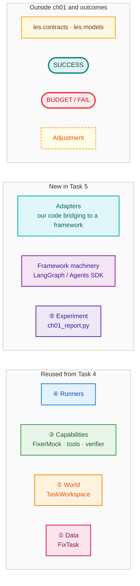
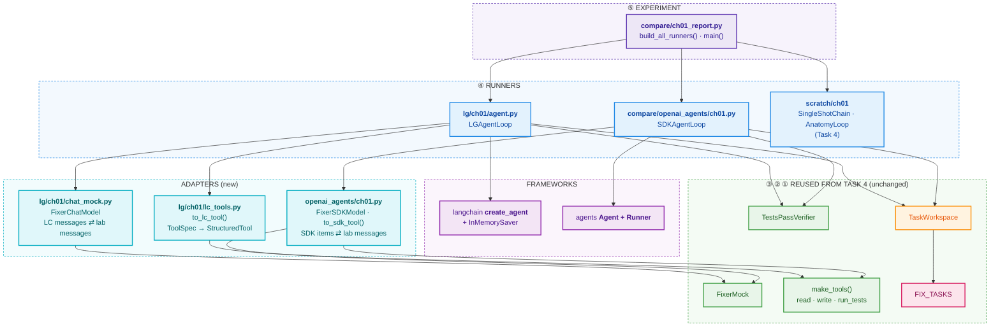
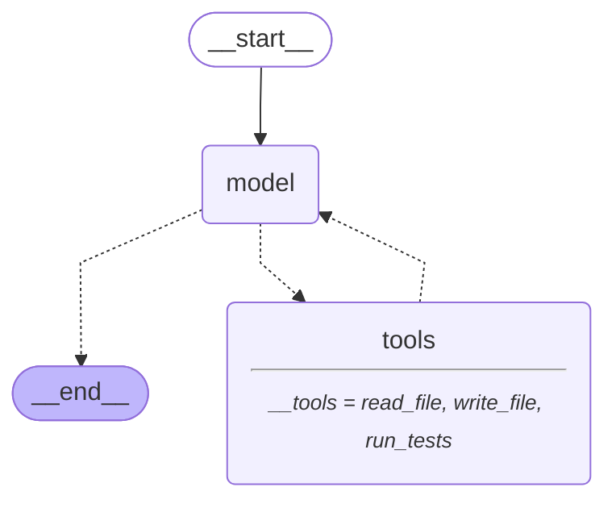
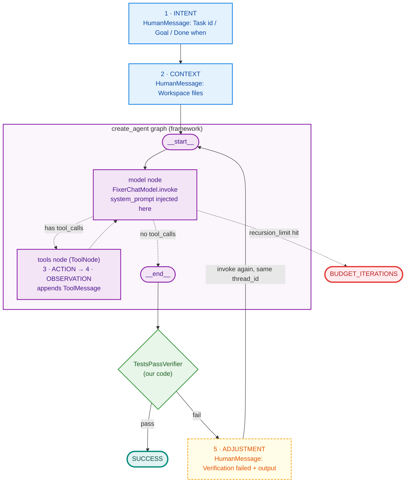
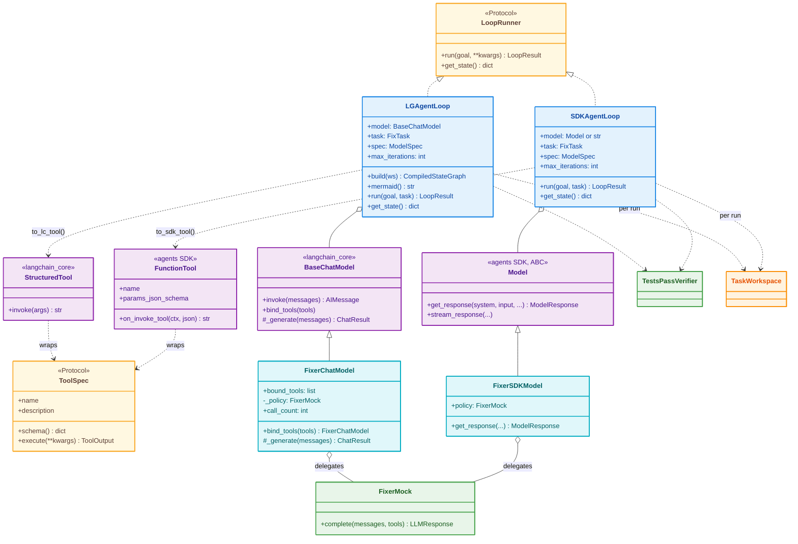
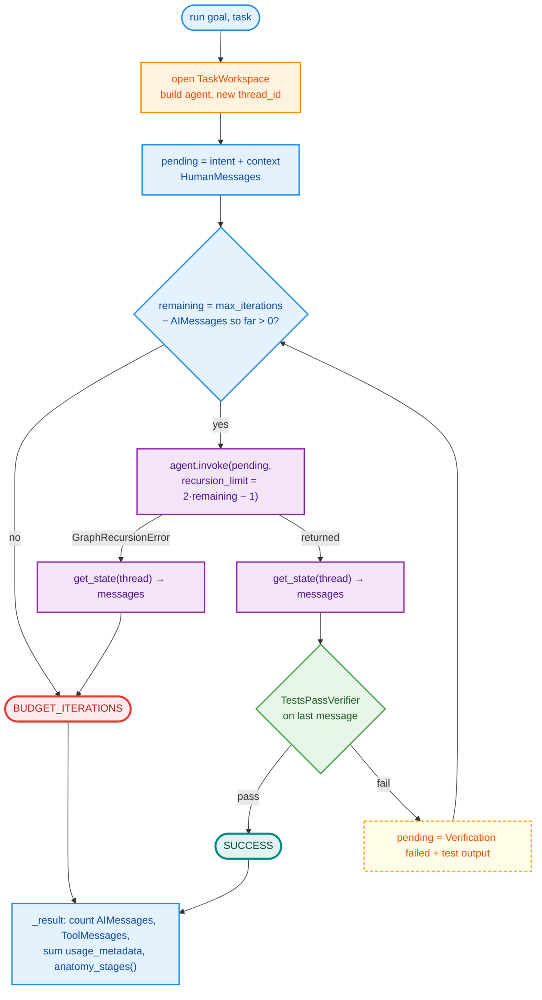
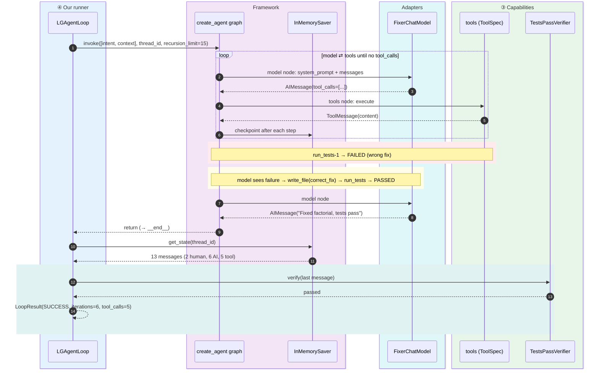
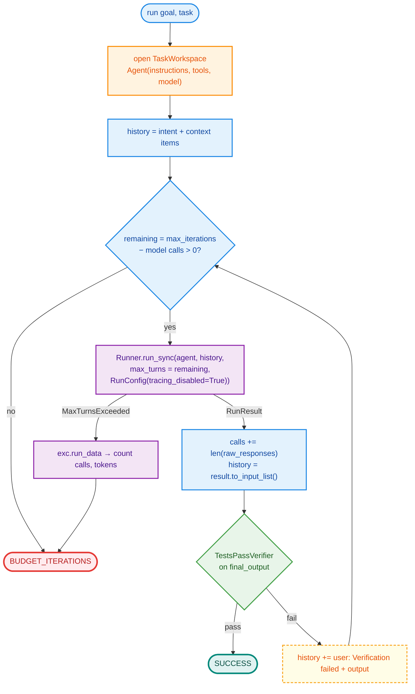

# Task 5: Ch 1 LangGraph build and OpenAI Agents SDK spike

> Modules: `src/les/lg/ch01/` (LangGraph build) · `src/les/compare/openai_agents/ch01.py` (comparison spike) · `src/les/compare/ch01_report.py` (cross-build report)
> Tests: `tests/lg/test_ch01_lg.py`, `tests/compare/test_ch01_openai_agents.py`, `tests/contract/test_ch01_contract.py`
> Run: `uv run python -m les.compare.ch01_report` · graph only: `uv run python -m les.compare.ch01_report --graph`
> Prerequisite: [Task 4 walkthrough](task04_scratch_walkthrough.md) (the scratch build these reuse)

---

## 1. What Task 5 demonstrates

Task 4 hand-wrote the five-stage loop. Task 5 asks: **what does a framework give you, and what do you still have to add yourself?**

We rebuilt the same Fix-the-function loop twice more:

| Build | The inner loop (action ⇄ observation) is… |
|---|---|
| Scratch `AnatomyLoop` (Task 4) | our own `while` loop |
| **LangGraph** `LGAgentLoop` | the graph compiled by `langchain.agents.create_agent` |
| **OpenAI Agents SDK** `SDKAgentLoop` | `Runner.run_sync(agent, ...)` |

All three use the **same model policy** (`FixerMock`), the **same tools** and the **same verifier**. Only the loop machinery differs:

| Runner | Solved | Mean iterations | Tokens |
|---|---|---|---|
| chain (scratch) | 5/10 | 1.0 | 1,449 |
| loop (scratch) | 10/10 | 5.0 | 7,797 |
| **langgraph** | **10/10** | **5.0** | **7,797** |
| **openai_sdk** | **10/10** | **5.0** | **7,797** |

Identical numbers, and identical five-stage traces for every task (a parametrised parity test checks this). That is the result we wanted: **the frameworks package the same loop.** They don't change what the loop *is*.

### What the frameworks gave us, and what they didn't

| Concern | Scratch | LangGraph `create_agent` | Agents SDK `Runner` |
|---|---|---|---|
| model ⇄ tools cycle | we wrote it | ✅ built in | ✅ built in |
| tool dispatch + unknown-tool errors | we wrote it | ✅ `ToolNode` | ✅ built in |
| iteration budget | `max_iterations` | `recursion_limit` (graph *steps*) | `max_turns` (model *calls*) |
| state / persistence | `get_state()` dict | ✅ checkpointer + `thread_id` | `to_input_list()` (in memory) |
| **grounded verification** | `TestsPassVerifier` | ❌ **we add it** | ❌ **we add it** |
| **adjustment after a rejected answer** | loop continues | ❌ **we add it** (resume thread) | ❌ **we add it** (re-run with history) |
| graph visualisation | hand-drawn | ✅ `get_graph().draw_mermaid()` | ❌ |
| tracing | none yet | LangSmith (if env set) | **on by default** → we disable it |

**Key lesson:** both frameworks stop when the *model* says it is done. Neither checks the claim. Grounding (stage 5) stays your job, which is the Ch 1 thesis showing up again in Ch 8.

---

## Colour key

The Task 4 colours, plus two new kinds of code introduced in this task:



---

## 2. Package map: what's reused, what's new

The design rule is to **reuse every Task 4 piece that isn't loop machinery**. New code is either a *runner* (the loop on a framework) or an *adapter* (translating our types to a framework's types).



| File | Responsibility |
|---|---|
| `lg/ch01/chat_mock.py` | `FixerChatModel`: `FixerMock` exposed as a LangChain `BaseChatModel` (with `bind_tools`) |
| `lg/ch01/lc_tools.py` | `to_lc_tool()`: wraps any `ToolSpec` as a LangChain `StructuredTool` |
| `lg/ch01/agent.py` | `LGAgentLoop` (`LoopRunner`): `create_agent` plus verifier, budget and resume |
| `compare/openai_agents/ch01.py` | `FixerSDKModel`, `to_sdk_tool()`, `SDKAgentLoop` (`LoopRunner`), `sdk_model()` |
| `compare/ch01_report.py` | Runs all four Ch 1 runners and prints one table, or the graph with `--graph` |

---

## 3. The compiled graph (`agent.get_graph().draw_mermaid()`)

This is the **raw output** of `uv run python -m les.compare.ch01_report --graph`, pasted unchanged:



Dotted edges are **conditional**. After `model`, a router checks *"does the last `AIMessage` have `tool_calls`?"*. If yes it goes to `tools`, otherwise to `__end__`.

### The same graph mapped onto the five stages

The graph only contains stages 3–4. Our `LGAgentLoop` wraps it with stages 1, 2 and 5:



---

## 4. Class diagram



**Adapter pattern.** `FixerChatModel` and `FixerSDKModel` are thin translators around **one** `FixerMock`. Neither re-implements the policy. That is why the three builds produce byte-identical token counts: any difference you *would* see must come from the loop machinery, which is exactly what a comparison spike is supposed to isolate.

---

## 5. File-by-file walkthrough

### 5.1 `lg/ch01/chat_mock.py`: `FixerChatModel`

`create_agent` accepts any LangChain `BaseChatModel` and calls `model.bind_tools(tools)` before every model step. A scripted model therefore needs to:

1. **Implement `_generate()`**: convert LangChain messages to lab messages (`to_lab_messages`), call `FixerMock.complete()`, and convert the `LLMResponse` back (`to_ai_message`).
2. **Implement `bind_tools()`**: return a *copy* holding the tool schemas, so `FixerMock` sees `tools` and switches from chain mode to loop mode.

| LangChain | ⇄ | Lab |
|---|---|---|
| `SystemMessage` / `HumanMessage` | | `Message("system")` / `Message("user")` |
| `AIMessage(content, tool_calls=[{name, args, id}])` | | `LLMResponse(text, tool_calls=[ToolCall])` |
| `ToolMessage(content, tool_call_id)` | | `Message("tool", content, tool_call_id)` |
| `AIMessage.usage_metadata` = `{input_tokens, output_tokens, total_tokens}` | | `prompt_tokens`, `completion_tokens` |

**Pydantic detail:** `BaseChatModel` is a Pydantic model, so a plain `self._policy = ...` in `__init__` is not allowed. Public config goes in `Field(...)`, and the internal policy is a `PrivateAttr`. `model_copy()` is a *shallow* copy, so the bound copy already shares the same `_policy` object (checked). `bind_tools` still re-assigns it explicitly so the sharing is visibly intentional, not an accident of copy semantics. The bound copy and the original share one call counter, which a test checks.

### 5.2 `lg/ch01/lc_tools.py`: `to_lc_tool()`

```python
def to_lc_tool(spec: ToolSpec) -> StructuredTool:
    def _run(**kwargs): return spec.execute(**kwargs).content
    return StructuredTool.from_function(func=_run, name=spec.name,
                                        description=spec.description,
                                        args_schema=spec.schema())   # plain JSON Schema dict
```

LangChain accepts a JSON Schema **dict** as `args_schema`, so the `ToolSpec.schema()` from Task 3 plugs straight in with no Pydantic model needed. Tools never raise (a Task 4 rule), so errors come back as strings and become `ToolMessage`s the model can read.

### 5.3 `lg/ch01/agent.py`: `LGAgentLoop`

```python
agent = create_agent(model, to_lc_tools(make_tools(ws)),
                     system_prompt=SYSTEM_PROMPT,
                     checkpointer=InMemorySaver())
```

**The outer loop** (our code, around the graph):



**Design points**

1. **Why `recursion_limit = 2·k − 1`?** LangGraph counts *super-steps* (node executions), not model calls. One iteration is `model` then `tools`, which is 2 steps. A run of `k` model calls that ends on a final answer takes `model, tools, …, model` = `2k − 1` steps. We verified this empirically. With limit 3 the graph runs `model, tools, model` and raises before the second `tools`. The parametrised test `test_recursion_limit_enforces_iteration_budget` checks budgets 1, 2 and 3.
2. **Why a checkpointer in Ch 1?** `agent.invoke()` *raises* `GraphRecursionError` and returns nothing, so without a checkpointer the conversation is lost. With `InMemorySaver` and a `thread_id`, `agent.get_state(config)` still returns every message up to the failure. The same mechanism also gives us **resume**: invoking again on the same `thread_id` with one new `HumanMessage` makes the `add_messages` reducer append it to the saved history. That is the adjustment step. (Ch 3 swaps in `SqliteSaver` for crash-safe resume.)
3. **The system prompt is not in the state.** `create_agent(system_prompt=...)` adds it at *call time* on every model step. `get_state()` holds only Human, AI and Tool messages. This is good, since there's one less message to store, but surprising the first time you see it.
4. **`anatomy_stages(messages)`** rebuilds the stage trace from the message history after the run, because we don't own the inner loop and can't record stages as they happen. It uses the same vocabulary as scratch, so the parity test can compare them directly.
5. **`mermaid()`** builds the graph and returns `get_graph().draw_mermaid()`. That is how §3 was produced.

#### Sequence: `factorial` on LangGraph



### 5.4 `compare/openai_agents/ch01.py`: the Agents SDK spike

Three pieces, mirroring the LangGraph side:

**a) `FixerSDKModel(Model)`.** The SDK calls `await model.get_response(system_instructions, input, ...)`. `input` is a list of **Responses-API items**:

| SDK input item | → lab `Message` |
|---|---|
| `{"role": "user", "content": "..."}` | `Message("user", ...)` |
| `{"type": "function_call", "call_id", "name", "arguments"}` | *skipped* (scratch doesn't store requests either) |
| `{"type": "function_call_output", "call_id", "output"}` | `Message("tool", output, tool_call_id=call_id)` |
| `{"role": "assistant", "content": [{"type": "output_text", "text"}]}` | `Message("assistant", text)` |

The response goes back as a `ModelResponse` holding either `ResponseFunctionToolCall` items or one `ResponseOutputMessage`, plus `Usage(input_tokens, output_tokens)`.

**b) `to_sdk_tool(spec)`** builds `FunctionTool(name, description, params_json_schema=spec.schema(), on_invoke_tool=async fn, strict_json_schema=False)`. The SDK passes arguments as a **JSON string**, so we `json.loads` them. `strict_json_schema=False` is needed because our hand-written schemas don't follow OpenAI's strict-mode rules (`additionalProperties: false`, every property required).

**c) `SDKAgentLoop`**



- **`max_turns` counts model calls directly**, so it maps 1:1 onto `max_iterations` with no `2k − 1` arithmetic.
- **No checkpointer.** State is the item list: `result.to_input_list()` gives the full history, and we append feedback and run again. On `MaxTurnsExceeded`, `exc.run_data` still carries the responses so far.
- **Tracing is on by default** in the Agents SDK and uploads traces to OpenAI. `RunConfig(tracing_disabled=True)` keeps the spike offline and private.
- **`sdk_model(alias)`** maps `models.yaml`. `mock` gives `FixerSDKModel`. `openai` gives the model name string. `ollama`/`vllm` give `OpenAIChatCompletionsModel` on an `AsyncOpenAI(base_url=...)` client. Anthropic isn't wired up (it would need LiteLLM), so it raises `ValueError`.

### 5.5 `compare/ch01_report.py`

`build_all_runners(model)` extends Task 4's `build_runners()` (chain + loop) with `langgraph` and `openai_sdk` factories, and reuses Task 4's `compare()` and `render_markdown()` unchanged. On the mock, LangGraph gets `FixerChatModel`. On a real alias it gets `les.models.chat_model(alias)`, and the SDK gets `sdk_model(alias)`.

---

## 6. Framework comparison at a glance

| | Scratch `AnatomyLoop` | LangGraph `create_agent` | OpenAI Agents SDK |
|---|---|---|---|
| Loop owner | our `while` | compiled `StateGraph` (`model` ⇄ `tools`) | `Runner.run` |
| Message format | lab `Message` | LangChain `BaseMessage` | Responses-API item dicts |
| Tool format | `ToolSpec` | `StructuredTool` (`args_schema` = JSON Schema) | `FunctionTool` (`params_json_schema`, JSON-string args) |
| Model plug-in | `LLMClient.complete()` | `BaseChatModel._generate()` + `bind_tools()` | `Model.get_response()` (async) |
| Budget knob | `max_iterations` | `recursion_limit` = graph steps (2k − 1) | `max_turns` = model calls (k) |
| Budget exceeded → | `BUDGET_ITERATIONS` returned | `GraphRecursionError` raised | `MaxTurnsExceeded` raised |
| State after budget stop | in `self._state` | ✅ via checkpointer `get_state()` | via `exc.run_data` |
| Resume | not yet (Ch 3) | ✅ same `thread_id` | re-run with `to_input_list()` |
| System prompt | first message | injected per call (not in state) | `instructions`, passed per call |
| Visualisation | hand-drawn | ✅ `draw_mermaid()` | — |
| Default tracing | — | off unless LangSmith env vars are set | **on**, uploads to OpenAI |
| Stage trace | recorded live | rebuilt from messages | rebuilt from items |

---

## 7. Tests

| File | What it covers |
|---|---|
| `tests/lg/test_ch01_lg.py` | **Conversion**: roles, tool calls, usage. **FixerChatModel**: chain mode without tools; `bind_tools` switches to loop mode and shares the policy. **lc_tools**: wraps `ToolSpec`, soft errors pass through. **LGAgentLoop**: solves `factorial` (6 iterations / 5 tools); **parity with scratch on all 10 tasks** (iterations, tools, tokens, stages); `recursion_limit` enforces budgets 1/2/3; a model that only claims "done!" gets verification feedback on the same thread; state is JSON-safe; `mermaid()` shows the model ⇄ tools cycle. **anatomy_stages**. |
| `tests/compare/test_ch01_openai_agents.py` | **Conversion**: SDK items ⇄ lab messages; tool-call and text responses. **to_sdk_tool** invokes the `ToolSpec`. **FixerSDKModel** chain mode. **SDKAgentLoop**: solves `factorial`; **parity with scratch on all 10 tasks**; `max_turns` enforces budgets 1/2/3; state is JSON-safe. **sdk_model** alias mapping. **ch01_report**: all four builds on the mock (chain 5/10, the rest 10/10 with equal tokens); `--graph` flag. |
| `tests/contract/test_ch01_contract.py` | The same 5 contract checks, now run against **4 registered runners**: `ch01_scratch_chain`, `ch01_scratch_loop`, `ch01_lg`, `ch01_oai_sdk`. The `ch01_lg` slot that was skipped in Task 4 now runs and passes. |

`uv run pytest -q` gives 169 passed and 5 skipped (the 5 skips are tasks with no wrong fix to test).

---

## 8. Gotchas learned in this task

1. **`recursion_limit` counts graph steps, not model calls.** Use `2k − 1` for `k` model calls in a `create_agent` graph.
2. **`invoke()` raises on the limit, and the result is lost without a checkpointer.** Always attach one if you need the partial trajectory.
3. **After a `GraphRecursionError`, the saved state can end with an `AIMessage` whose `tool_calls` were never answered.** Real providers reject a new `HumanMessage` after unanswered tool calls, so don't resume a thread like that without first adding `ToolMessage`s (or removing the call). We stop in that case, so it never happens here. It will matter for Ch 3 resume.
4. **The `system_prompt` isn't stored in the graph state.** Don't look for it in `get_state()`.
5. **`BaseChatModel` is Pydantic.** Use `Field` / `PrivateAttr`, and remember that `model_copy()` and private attributes need care (see `bind_tools`).
6. **The Agents SDK uploads traces by default.** Disable them with `RunConfig(tracing_disabled=True)` (or `set_tracing_disabled(True)`) for offline or private work.
7. **SDK tool args arrive as a JSON string,** and the strict schema mode needs OpenAI-strict schemas. Use `strict_json_schema=False` for hand-written ones.
8. **One small parity difference.** When the *last* allowed model call's answer fails verification, scratch appends the feedback message to its local history, while LangGraph and the SDK never send it (there is no budget left to resume). So in that edge case the frameworks record one fewer `adjustment` stage. The main parity tests aren't affected, since they never hit it.

---

## 9. Running it

```bash
uv run python -m les.compare.ch01_report               # all four builds, offline mock
uv run python -m les.compare.ch01_report --graph       # Mermaid of the compiled graph
uv run python -m les.compare.ch01_report --model local # needs Ollama running (see note)
uv run pytest tests/lg tests/compare tests/contract -q
```

**Real-model note:** the LangGraph path uses `les.models.chat_model(alias)`, a real LangChain chat model that sends tool-call history correctly, so it does **not** have the Task 4 `OpenAIAdapter` limitation. The scratch runners still do.

## 10. What's next

- **Task 6** (Ch 2 scratch): ReAct vs plan-and-execute state machines, with async tool calls.
- **Task 7** (Ch 2 LangGraph): hand-build the `StateGraph` that `create_agent` gave us here (`agent` node, `ToolNode`, conditional edge), so the graph in §3 stops being a black box.
- **Task 9** (Ch 3): replace `InMemorySaver` with `SqliteSaver` for crash-safe resume, and handle gotcha 3.
